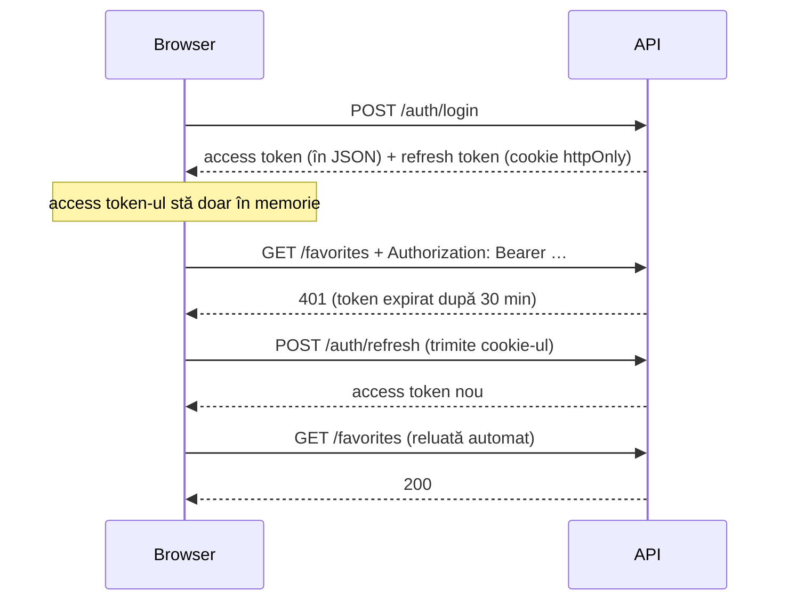
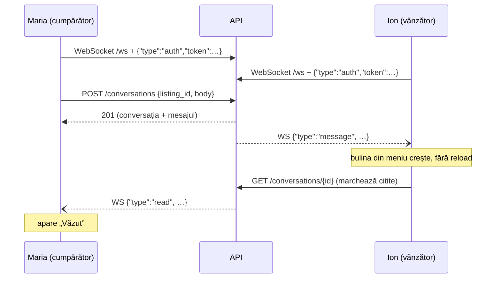

# Golden Marketplace — marketplace de mașini

Proiect de laborator: o platformă unde utilizatorii publică anunțuri de vânzare
auto cu poze, iar vizitatorii le caută, le filtrează și le salvează la favorite.

| Strat | Tehnologie |
|---|---|
| Frontend | React 19 + TypeScript + Vite + Tailwind CSS + React Router |
| Backend | Python, FastAPI, SQLAlchemy 2.0, Alembic, Pydantic v2 |
| Bază de date | PostgreSQL 16 (Docker Compose) |
| Autentificare | JWT (PyJWT) + bcrypt |
| Imagini | Pillow, stocate pe disc |
| Timp real | WebSocket (FastAPI) pentru notificările de mesaje |
| Plăți | Stripe Checkout (mod de test) pentru promovarea anunțurilor |
| Publicare | Docker: Apache (cu `.htaccess`) în fața FastAPI, pe Render |
| Teste | 76 unitare (pytest, Vitest) + 167 end-to-end în Firefox, rulate automat de GitHub Actions |

<p>
  
  
</p>

## Funcționalități

- **Căutare**: listă paginată cu 12 filtre (marcă, model, preț, an, kilometraj,
  combustibil, cutie, caroserie, oraș, text liber) și 5 sortări. Filtrele stau
  în URL: linkul se poate trimite, iar butonul Back revine la căutarea anterioară.
- **Pagina anunțului**: galerie cu miniaturi și ecran complet (cu săgeți de la
  tastatură), specificații, date despre vânzător, număr de vizualizări.
- **Conturi**: înregistrare, autentificare, sesiune păstrată după închiderea
  tab-ului (7 zile), profil editabil.
- **Publicare anunț**: formular cu validare în română, încărcare de până la 15
  poze (cele de peste 5 MB se micșorează automat în browser), alegerea pozei
  principale, salvare ca ciornă.
- **Anunțurile mele**: editare, publicare, „vândut”, dezactivare, ștergere.
- **Administrator**: poate edita și șterge orice anunț, din pagina anunțului (cu confirmare).
  Nu are acces la mesajele private dintre utilizatori.
- **Favorite**: o inimă pe fiecare anunț și o pagină cu cele salvate.
- **Mesaje în timp real** între cumpărător și vânzător: mesajele, bulina de
  necitite și confirmarea „Văzut” apar instant, fără reîncărcarea paginii.
- **Promovare plătită** prin Stripe: anunțul apare primul în listă și în caruselul
  de pe prima pagină, 7 zile; istoricul plăților e în profil.
- **Carusel** pe prima pagină: anunțurile promovate (sau cele mai noi), derulare automată.
- **CAPTCHA** la înregistrare, generat de server.
- **Jurnal de activitate**: acțiunile utilizatorilor, scrise în `backend/logs/activity.log`.
- **Responsive**: funcționează pe telefon, tabletă și desktop.

---

## Cerințele din barem: unde se găsesc

| Nota | Cerință | Unde / cum |
|---|---|---|
| 2 | Baza de date în 3NF | 7 tabele (`backend/app/models/`); fără date deduse: vânzătorul conversației vine din anunț, perioada de promovare stă pe plată |
| 2 | ≥4 scenarii | publicare anunț cu poze, căutare cu filtre, favorite, mesaje, promovare plătită, ștergere de admin |
| 2 | Arhitectură | pe straturi (≈ MVC): `models/` (date), `schemas/` (validare), `routers/` (controllere), `services/` (logică), React (view) |
| 2 | Imagini, text, tabele, linkuri | poze în galerie și carusel; `<table>` la specificații și la plăți (`ListingDetail.tsx`, `Profile.tsx`) |
| 3 | ≥3 clase | modelele SQLAlchemy, `LocalImageStorage`, `ConnectionManager`, middleware-urile, `ApiError` |
| 3 | Interfață | `ImageStorage` (Protocol, `services/storage.py`) implementată de `LocalImageStorage`; `interface` TypeScript în `types/index.ts` |
| 3 | Autentificare / autorizare | JWT + bcrypt; proprietar / admin (`_require_owner`), rute protejate, `AdminUser` |
| 4 | Moștenire | `User(Base, TimestampMixin)`, `UserRead(UserPublic)`, `ImageValidationError(ValueError)`, `ApiError extends Error`, `ListingDetail extends ListingCard` |
| 4 | ≥2 tipuri de excepții | `ImageValidationError`, `CaptchaError`, `PaymentError`, `IntegrityError`, `HTTPException`, `ApiError` |
| 4 | Carusel | `components/FeaturedCarousel.tsx`: derulare la 5 s, pauză la hover, săgeți, buline |
| 4 | Animație | `styles/components.css`: apariția cardurilor, bulina care pulsează, bara caruselului |
| 5 | ≥2 fișiere CSS, ≥10 proprietăți | `src/index.css` (Tailwind) și `src/styles/components.css` (CSS scris de mână, 35 de proprietăți distincte) |
| 5 | Responsive | testat automat la 390 / 768 / 1280 px |
| 6 | ≥5 teste unitare | 59 pytest (`backend/tests/`) + 17 Vitest (`*.test.ts`) |
| 6 | Git | istoric cu commit-uri pe etape |
| 6 | CI/CD | `.github/workflows/ci.yml`: teste unitare, lint și build la fiecare push |
| 7 | Logging | `core/activity.py` → `backend/logs/activity.log`; adminul îl citește la `GET /admin/activity-log` |
| 7 | Hosting | https://golden-marketplace.onrender.com — `Dockerfile` + `render.yaml` (Render, plan gratuit) |
| 8 | SEO ≥ 90 | Lighthouse pe site-ul publicat: **SEO 100**, accesibilitate 100 (meta description per anunț, `robots.txt`, Open Graph) |
| 8 | Plăți online | Stripe Checkout (`services/payments.py`), confirmare verificată la Stripe, webhook semnat |
| 9 | CSRF | token în header (nu cookie) + cookie `SameSite` + verificarea `Origin` (`OriginCheckMiddleware`) |
| 9 | XSS | React escapează textul (testat cu ``), CSP strict |
| 9 | SQL injection | doar interogări parametrizate (SQLAlchemy), niciun SQL construit din text |
| 9 | Fișiere ≤ 12 MB | limita e 5 MB pe fișier, verificată înainte de citire; Apache limitează corpul cererii |
| 9 | Extensii aprobate | `.jpg .jpeg .png .webp` pe server (`check_extension`) **și** conținutul real (Pillow) |
| 10 | Rate limiting | `RateLimitMiddleware`: 100 cereri/minut per IP → 429 cu `Retry-After` |
| 10 | CAPTCHA | `services/captcha.py`: imagine generată, token semnat, folosire unică |
| 10 | Steganografie | fiecare poză e decodată și re-codificată (redimensionare + JPEG nou): EXIF, date lipite și mesaje ascunse în pixeli dispar; testat |
| 10 | Antete de securitate (A) | **A+** pe securityheaders.com (22.10.2026). `.htaccess` + `SecurityHeadersMiddleware`: CSP, HSTS, X-Frame-Options, nosniff, Referrer-Policy, Permissions-Policy |
| 10 | `.htaccess` | `frontend/public/.htaccess`: `.env`, fișiere ascunse, cod, copii de siguranță → 403; fără listarea folderelor; doar GET pe fișiere statice |

---

## Pornire

**Cerințe:** Docker + Docker Compose, Python 3.11+, Node.js 20+.

### Prima dată

```bash
# 1. Configurare (apoi schimbă SECRET_KEY din .env)
cp .env.example .env

# 2. Baza de date (PostgreSQL pe :5432, pgAdmin pe :5050)
docker compose up -d

# 3. Backend
cd backend
python -m venv .venv
source .venv/bin/activate        # pe Windows: .venv\Scripts\activate
pip install -r requirements.txt
alembic upgrade head             # creează tabelele
python seed.py                   # date de test: 3 conturi, 30 de anunțuri, 93 de poze

# 4. Frontend (în alt terminal)
cd frontend
cp .env.example .env
npm install
```

### De fiecare dată

```bash
docker compose up -d
cd backend && source .venv/bin/activate && uvicorn app.main:app --reload   # API pe :8000
cd frontend && npm run dev                                                 # aplicația pe :5173
```

Deschide **<http://localhost:5173>**. Folosește `localhost`, nu `127.0.0.1`: cookie-ul
de sesiune e legat de numele host-ului, iar API-ul rulează pe `localhost:8000`.

| Adresă | Ce e |
|---|---|
| <http://localhost:5173> | aplicația |
| <http://localhost:8000/docs> | documentația interactivă a API-ului (Swagger) |
| <http://localhost:8000/health> | `{"api":"ok","database":"ok"}` dacă totul merge |
| <http://localhost:5050> | pgAdmin (host-ul bazei de date este `db`, nu `localhost`) |

### Conturi de test

| Email | Parolă | Rol |
|---|---|---|
| ion@example.com | parola1234 | utilizator (are anunțuri) |
| maria@example.com | parola1234 | utilizator |
| admin@example.com | parola1234 | administrator (poate edita și șterge orice anunț, din pagina lui) |

> ⚠️ `seed.py` **șterge toate datele** (inclusiv conturile și anunțurile create
> din interfață) înainte să le recreeze. Pozele generate sunt plăci colorate cu
> marca și modelul, nu poze reale.

### Teste

**Teste unitare** (rapide, fără bază de date sau browser; rulate și de GitHub Actions):

```bash
cd backend && pytest          # 59 de teste: securitate, CAPTCHA, poze, rate limiting, CSRF, plăți
cd frontend && npm test       # 17 teste: formatare, validarea formularului
```

**Teste end-to-end** (aplicația completă, într-un Firefox real). Backend-ul se pornește
cu o limită de cereri mare, pentru că testele fac sute de cereri pe minut:

```bash
cd backend && RATE_LIMIT_PER_MINUTE=100000 uvicorn app.main:app --reload
cd frontend && npm run e2e    # 167 de verificări, ~2 minute
E2E_HEADFUL=1 npm run e2e     # cu fereastra browserului vizibilă
```

Testele folosesc aplicația ca un utilizator real: completează formulare,
încarcă poze (inclusiv un fișier fals și unul de 18 MB), verifică ce apare pe
ecran și ce s-a salvat în bază. Testul de mesagerie deschide două ferestre
(cumpărător și vânzător) și repornește backend-ul la mijloc, ca să verifice
reconectarea automată. Detalii în [`frontend/e2e/README.md`](frontend/e2e/README.md).

### Versiunea de producție (Apache + Docker)

```bash
docker compose --profile prod up --build     # http://localhost:8080
```

Imaginea (`Dockerfile`) conține Apache, frontend-ul construit și FastAPI. Apache
servește aplicația, aplică regulile din `.htaccess` și trimite `/api/*` (inclusiv
WebSocket-ul) către FastAPI. Local folosește o bază de date separată, ca `seed.py`
să nu atingă datele de dezvoltare. Pe Render se publică din `render.yaml`
(render.com → New → Blueprint → repo-ul).

---

## Arhitectură

```
 Browser (React, :5173)                 FastAPI (:8000)                  PostgreSQL
 ┌──────────────────────┐   JSON + JWT   ┌───────────────────────┐  SQL   ┌──────────┐
 │ pagini → api/*.ts    │ ─────────────► │ routers → services    │ ─────► │ users    │
 │ client.ts            │                │ (validare Pydantic,   │        │ listings │
 │  · token în memorie  │ ◄───────────── │  verificare drepturi) │        │ images   │
 │  · refresh la 401    │                └──────────┬────────────┘        │ favorites│
 └──────────────────────┘                           │ Pillow              └──────────┘
          ▲              ▼
          └──────────────────────────── backend/uploads/listings/{id}/*.jpg
          ▲
          └─ WebSocket /ws: notificări „mesaj nou” / „citit” (doar server → browser)
```

### Structura

```
backend/app/
├── main.py            # aplicația, CORS, fișiere statice, /health
├── core/              # config (.env), securitate (bcrypt, JWT), dependențe (utilizatorul curent)
├── models/            # tabelele SQLAlchemy
├── schemas/           # formatul cererilor și răspunsurilor (Pydantic)
├── routers/           # auth, users, listings, images, favorites, conversations, ws
└── services/          # storage.py (poze pe disc), listing_service.py, realtime.py (conexiuni WebSocket)

frontend/src/
├── api/               # client.ts (token, refresh, erori) + câte un fișier per resursă
├── context/           # AuthContext (cine e logat), RealtimeContext (conexiunea WebSocket)
├── routes/            # ProtectedRoute: redirect la /login
├── pages/             # câte o pagină per rută
├── components/        # ListingCard, Filters, ImageGallery, ImageUploader, …
├── lib/               # format.ts (etichete în română), validare formular, poze
└── types/             # tipurile TypeScript, oglindă a schemelor din backend
```

### Fluxul de autentificare



### Mesageria în timp real



| Decizie | De ce |
|---|---|
| Mesajele se **scriu prin REST**, WebSocket-ul doar **notifică** | Validarea, drepturile și salvarea trec prin același cod ca restul API-ului. Dacă WebSocket-ul cade, nu se pierde nimic: mesajul e în bază și apare la reîncărcare. |
| Tokenul se trimite în **primul mesaj** pe WebSocket, nu în URL | Browserul nu poate pune `Authorization` pe un WebSocket, iar un URL cu token ajunge în log-urile serverului. Și fiindcă nu folosim cookie-ul, alt site nu poate deschide conexiunea în numele utilizatorului. |
| **Reconectare automată** cu pauze crescătoare (1s, 2s, 4s… max 15s) | Rețeaua sau serverul pot cădea. După reconectare, paginile își reîncarcă datele ca să prindă mesajele pierdute. |
| O conversație per (anunț, cumpărător), cu `UNIQUE` în bază | Al doilea „Trimite mesaj” continuă discuția existentă; constrângerea rezolvă și dublu-click-ul. |
| Doar participanții văd conversația (**404** pentru ceilalți, inclusiv admin) | Mesajele private nu sunt treaba administratorului; 404 în loc de 403 nu dezvăluie ce id-uri există. |
| Textul mesajului e afișat de React ca **text** | Un `<script>` sau `` trimis ca mesaj apare literal, nu rulează (testat). |

Limitare: conexiunile WebSocket stau în memoria procesului, deci merge cu un
singur worker uvicorn. Cu mai multe procese ar fi nevoie de un canal comun
(ex. Redis pub/sub).

### Fluxul de publicare

```
POST /listings              → anunț nou cu status "draft" (invizibil în lista publică)
POST /listings/{id}/images  → câte o cerere per poză (progres vizibil, eroare clară per fișier)
POST /listings/{id}/publish → devine "active"; refuzat cu 400 dacă nu are nicio poză
```

Pozele au nevoie de un `listing_id`, deci anunțul trebuie să existe înainte. Dacă
o poză e respinsă, anunțul rămâne ciornă și utilizatorul ajunge pe pagina de
editare cu motivul exact (ex. „fals.jpg: Fișierul nu este o imagine validă”).

---

## Decizii tehnice

### Securitate

| Decizie | De ce |
|---|---|
| Parole hash-uite cu **bcrypt** | Hash lent, cu salt: o bază de date furată nu dezvăluie parolele. |
| **Access token** (30 min) ținut **în memorie**, nu în `localStorage` | Un script injectat (XSS) poate citi `localStorage`, dar nu o variabilă din modulul JS. |
| **Refresh token** (7 zile) în cookie `httpOnly`, `path=/auth` | JavaScript nu îl poate citi deloc și se trimite doar către rutele de autentificare. |
| Același mesaj pentru email inexistent și parolă greșită | Nu dezvăluie ce conturi există. |
| **Telefonul vânzătorului** se trimite doar utilizatorilor logați | Altfel ar fi colectat automat de roboți. Lipsește chiar din răspunsul API, nu e doar ascuns în pagină. |
| Pozele validate după **conținut** (Pillow), nu după extensie | Extensia și `Content-Type` se pot falsifica; un fișier text redenumit `.jpg` e respins. |
| Nume de fișiere generate (UUID) | Fără coliziuni și fără căi controlate de utilizator. |
| Verificarea proprietarului pe server (`_require_owner`) | Ascunderea butonului „Editează” în interfață nu e o protecție: API-ul refuză cu 403. |
| CORS doar pentru originea frontend-ului | Alte site-uri nu pot chema API-ul cu cookie-ul utilizatorului. |

### Date

- **Prețul e `Numeric(10,2)`**, nu `Float`: `0.1 + 0.2 ≠ 0.3` în virgulă mobilă.
  Prețul circulă ca string (`"18500.00"`) până în frontend, unde e doar formatat.
- **Doar căile pozelor se salvează în bază**, nu fișierele. Baza rămâne mică, iar
  pozele se servesc direct ca fișiere statice.
- **Trei variante per poză**: `full` (1600×1200) pe ecran complet, `medium`
  (800×600) în listă și pe pagina anunțului, `thumb` (400×300) la miniaturi.
  Un card nu descarcă o poză de 3 MB.
- **Ștergerea unui anunț**: rândurile din `car_images` dispar prin
  `ON DELETE CASCADE`, iar folderul de pe disc se șterge explicit în cod. Baza de
  date nu știe de fișiere.
- **Indexuri** pe coloanele filtrate și unul compus pe `(status, created_at)`,
  pentru interogarea cea mai frecventă: anunțurile active, cele mai noi primele.
- **Vizualizările proprii nu se numără.**

### Frontend

- **Filtrele în URL** (`useSearchParams`), nu în state: o căutare se poate
  trimite ca link, iar Back/Forward funcționează.
- **Lista se cere abia după verificarea sesiunii.** Altfel prima cerere ar pleca
  fără token, iar inimile de la favorite ar apărea goale.
- **Refresh-ul se face o singură dată.** Dacă mai multe cereri primesc 401
  simultan, toate așteaptă aceeași promisiune de refresh.
- **Etichetele în română** pentru valorile din API (`petrol` → „Benzină”) sunt
  într-un singur fișier, `lib/format.ts`. API-ul rămâne independent de limbă.
- **Validarea din formular repetă regulile din Pydantic**, pentru mesaje clare
  lângă fiecare câmp. Serverul validează oricum: validarea din browser e doar
  pentru confort, nu pentru securitate.
- **Pozele mari se micșorează în browser** (canvas → JPEG) înainte de upload:
  o poză de telefon de 10 MB ar fi refuzată de limita de 5 MB a serverului.

### Buguri găsite și rezolvate pe parcurs

| Bug | Cauză | Rezolvare |
|---|---|---|
| Același anunț putea apărea pe două pagini | Toate anunțurile din seed au același `created_at`; la valori egale, PostgreSQL nu garantează ordinea | `ORDER BY …, id` ca al doilea criteriu |
| A doua poză primea tot poziția 0 | `max_position or -1`: în Python `0` e „fals”, deci 0 devenea -1 | Am scos `or -1` (SQL-ul folosea deja `coalesce`) |
| O ciornă fără poze se putea publica | `PATCH {"status": "active"}` ocolea verificarea din `/publish` | Aceeași regulă și în `PATCH` |
| Fiecare vizualizare se număra de două ori (în dev) | React StrictMode rulează efectele de două ori | Cererile simultane pentru același anunț folosesc aceeași promisiune |
| pgAdmin repornea în buclă | Emailul `admin@carmarket.local`: domeniul `.local` e rezervat | Email cu domeniu valid |

---

## API

Documentația completă și interactivă: **<http://localhost:8000/docs>**.

### Autentificare
| Metodă | Rută | Descriere |
|---|---|---|
| POST | `/auth/register` | Creează cont (201) |
| POST | `/auth/login` | Autentificare |
| POST | `/auth/refresh` | Access token nou, din cookie |
| POST | `/auth/logout` | Șterge cookie-ul (204) |
| GET | `/users/me` | Datele contului |
| PATCH | `/users/me` | Nume / telefon |

### Anunțuri
| Metodă | Rută | Acces |
|---|---|---|
| GET | `/listings` | public, doar anunțurile active |
| GET | `/listings/mine` | autentificat, toate statusurile |
| GET | `/listings/{id}` | public (ciorna doar pentru proprietar) |
| POST | `/listings` | autentificat, creează ca **draft** |
| PATCH | `/listings/{id}` | proprietar |
| POST | `/listings/{id}/publish` | proprietar, cere cel puțin o poză |
| DELETE | `/listings/{id}` | proprietar sau admin |

Parametri la `GET /listings`: `q`, `brand`, `model`, `city`, `price_min`,
`price_max`, `year_min`, `year_max`, `mileage_max`, `fuel_type`, `transmission`,
`body_type`, `page`, `per_page` (1–60), `sort` (`recent`, `price_asc`,
`price_desc`, `year_desc`, `mileage_asc`).

```bash
curl "localhost:8000/listings?brand=bmw&price_max=30000&sort=price_asc"
```

### Imagini
| Metodă | Rută | Descriere |
|---|---|---|
| GET | `/listings/{id}/images` | Lista pozelor |
| POST | `/listings/{id}/images` | Upload (`multipart/form-data`, câmpul `files`) |
| PATCH | `/listings/{id}/images/{image_id}` | Poză principală / poziție |
| DELETE | `/listings/{id}/images/{image_id}` | Ștergere |

Limite: 5 MB per poză, 15 poze per anunț, JPEG / PNG / WEBP (configurabile în `.env`).

### Favorite
| Metodă | Rută | Descriere |
|---|---|---|
| GET | `/favorites` | Anunțurile salvate |
| POST | `/favorites/{listing_id}` | Salvează |
| DELETE | `/favorites/{listing_id}` | Scoate |

### Mesaje
| Metodă | Rută | Descriere |
|---|---|---|
| GET | `/conversations` | Conversațiile mele (ultimul mesaj, necitite) |
| GET | `/conversations/unread-count` | Total necitite (bulina din meniu) |
| POST | `/conversations` | Primul mesaj către vânzător `{listing_id, body}` (continuă discuția dacă există) |
| GET | `/conversations/{id}` | Firul complet; marchează ca citite mesajele primite |
| POST | `/conversations/{id}/messages` | Trimite `{body}` (1–2000 de caractere) |
| POST | `/conversations/{id}/read` | Marchează ca citit |
| WS | `/ws` | Notificări: `message`, `read`; primul mesaj trimis e `{"type":"auth","token":…}` |

Erorile au forma `{"detail": "mesaj în română"}`. La 422 (date invalide),
`detail` e o listă cu câmpurile greșite.

---

## Limitări și dezvoltări viitoare

- **Mai multe procese backend** cu mesagerie: Redis pub/sub între ele (acum: un singur proces).
- **Notificări** pe email sau push pentru mesajele primite cât utilizatorul e offline.
- **Panou de administrare**: statistici, listă cu toate anunțurile (ascundere / ștergere),
  blocarea conturilor (coloana `is_active` există deja). Acum adminul editează și șterge
  anunțuri din pagina fiecăruia.
- **Rapoarte de la utilizatori** („Raportează anunțul”) cu o listă de moderare.
- **Verificarea emailului** la înregistrare și resetarea parolei.
- **Căutare full-text** (PostgreSQL `tsvector`); acum se folosește `ILIKE`.
- **Conversie EUR/RON** la filtrul de preț; acum se compară doar numărul.
- **Stocare S3 / MinIO** pentru poze, în locul discului local.
- **Mai multe procese backend**: rate limiting-ul și conexiunile WebSocket stau în
  memorie; cu mai multe procese ar fi nevoie de Redis.
- **Stocare persistentă pentru poze** pe hosting (pe planul gratuit Render discul se
  golește la repornire, iar datele demonstrative se refac automat).
- **Reordonarea pozelor** prin drag & drop (API-ul suportă deja `position`).

## Comenzi utile

```bash
docker compose up -d          # pornește baza de date
docker compose down           # oprește (datele rămân)
docker compose down -v        # oprește și ȘTERGE datele
docker compose exec db psql -U carmarket -d carmarket   # consolă SQL

alembic revision --autogenerate -m "descriere"   # după modificarea unui model
alembic upgrade head
alembic downgrade -1

npm run build                 # verificare TypeScript + build de producție
npm run lint
```
