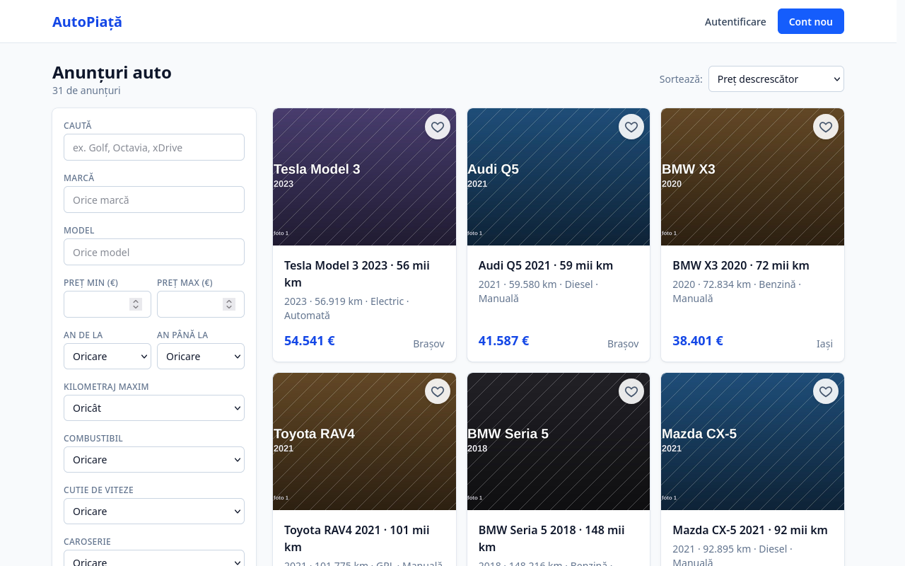
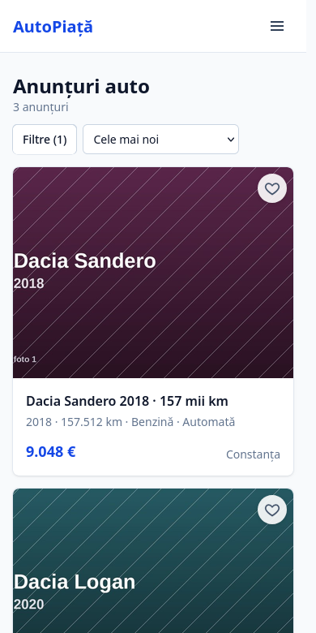
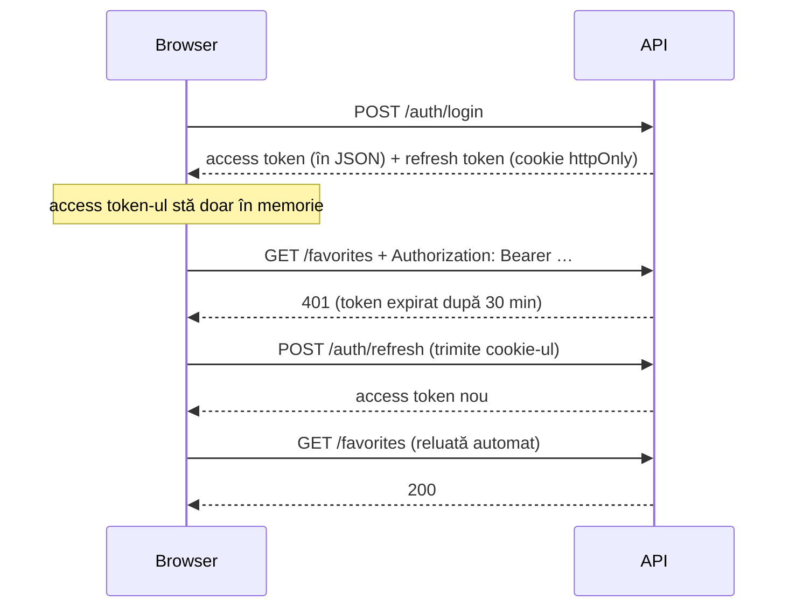

# AutoPiață — marketplace de mașini

Proiect de laborator: o platformă unde utilizatorii publică anunțuri de vânzare
auto cu poze, iar vizitatorii le caută, le filtrează și le salvează la favorite.

| Strat | Tehnologie |
|---|---|
| Frontend | React 19 + TypeScript + Vite + Tailwind CSS + React Router |
| Backend | Python, FastAPI, SQLAlchemy 2.0, Alembic, Pydantic v2 |
| Bază de date | PostgreSQL 16 (Docker Compose) |
| Autentificare | JWT (PyJWT) + bcrypt |
| Imagini | Pillow, stocate pe disc |
| Teste | 115 verificări end-to-end în Firefox (puppeteer-core) |

<p>
  
  
</p>

## Funcționalități

- **Căutare**: listă paginată cu 12 filtre (marcă, model, preț, an, kilometraj,
  combustibil, cutie, caroserie, oraș, text liber) și 5 sortări. Filtrele stau
  în URL: linkul se poate trimite, iar butonul Back revine la căutarea anterioară.
- **Pagina anunțului**: galerie cu miniaturi și ecran complet (cu săgeți de la
  tastatură), specificații, date despre vânzător, număr de vizualizări.
- **Conturi**: înregistrare, autentificare, sesiune păstrată după închiderea
  tab-ului (7 zile), profil editabil.
- **Publicare anunț**: formular cu validare în română, încărcare de până la 15
  poze (cele de peste 5 MB se micșorează automat în browser), alegerea pozei
  principale, salvare ca ciornă.
- **Anunțurile mele**: editare, publicare, „vândut”, dezactivare, ștergere.
- **Favorite**: o inimă pe fiecare anunț și o pagină cu cele salvate.
- **Responsive**: funcționează pe telefon, tabletă și desktop.

---

## Pornire

**Cerințe:** Docker + Docker Compose, Python 3.11+, Node.js 20+.

### Prima dată

```bash
# 1. Configurare (apoi schimbă SECRET_KEY din .env)
cp .env.example .env

# 2. Baza de date (PostgreSQL pe :5432, pgAdmin pe :5050)
docker compose up -d

# 3. Backend
cd backend
python -m venv .venv
source .venv/bin/activate        # pe Windows: .venv\Scripts\activate
pip install -r requirements.txt
alembic upgrade head             # creează tabelele
python seed.py                   # date de test: 3 conturi, 30 de anunțuri, 93 de poze

# 4. Frontend (în alt terminal)
cd frontend
cp .env.example .env
npm install
```

### De fiecare dată

```bash
docker compose up -d
cd backend && source .venv/bin/activate && uvicorn app.main:app --reload   # API pe :8000
cd frontend && npm run dev                                                 # aplicația pe :5173
```

Deschide **<http://localhost:5173>**. Folosește `localhost`, nu `127.0.0.1`: cookie-ul
de sesiune e legat de numele host-ului, iar API-ul rulează pe `localhost:8000`.

| Adresă | Ce e |
|---|---|
| <http://localhost:5173> | aplicația |
| <http://localhost:8000/docs> | documentația interactivă a API-ului (Swagger) |
| <http://localhost:8000/health> | `{"api":"ok","database":"ok"}` dacă totul merge |
| <http://localhost:5050> | pgAdmin (host-ul bazei de date este `db`, nu `localhost`) |

### Conturi de test

| Email | Parolă | Rol |
|---|---|---|
| ion@example.com | parola1234 | utilizator (are anunțuri) |
| maria@example.com | parola1234 | utilizator |
| admin@example.com | parola1234 | administrator (poate șterge orice anunț) |

> ⚠️ `seed.py` **șterge toate datele** (inclusiv conturile și anunțurile create
> din interfață) înainte să le recreeze. Pozele generate sunt plăci colorate cu
> marca și modelul, nu poze reale.

### Teste

Cu backend-ul și frontend-ul pornite:

```bash
cd frontend
npm run e2e                  # 115 verificări în Firefox headless, ~1,5 minute
E2E_HEADFUL=1 npm run e2e    # cu fereastra browserului vizibilă
```

Testele folosesc aplicația ca un utilizator real: completează formulare,
încarcă poze (inclusiv un fișier fals și unul de 18 MB), verifică ce apare pe
ecran și ce s-a salvat în bază. Detalii în [`frontend/e2e/README.md`](frontend/e2e/README.md).

---

## Arhitectură

```
 Browser (React, :5173)                 FastAPI (:8000)                  PostgreSQL
 ┌──────────────────────┐   JSON + JWT   ┌───────────────────────┐  SQL   ┌──────────┐
 │ pagini → api/*.ts    │ ─────────────► │ routers → services    │ ─────► │ users    │
 │ client.ts            │                │ (validare Pydantic,   │        │ listings │
 │  · token în memorie  │ ◄───────────── │  verificare drepturi) │        │ images   │
 │  · refresh la 401    │                └──────────┬────────────┘        │ favorites│
 └──────────────────────┘                           │ Pillow              └──────────┘
          ▲              ▼
          └──────────────────────────── backend/uploads/listings/{id}/*.jpg
```

### Structura

```
backend/app/
├── main.py            # aplicația, CORS, fișiere statice, /health
├── core/              # config (.env), securitate (bcrypt, JWT), dependențe (utilizatorul curent)
├── models/            # tabelele SQLAlchemy
├── schemas/           # formatul cererilor și răspunsurilor (Pydantic)
├── routers/           # auth, users, listings, images, favorites
└── services/          # storage.py (poze pe disc), listing_service.py

frontend/src/
├── api/               # client.ts (token, refresh, erori) + câte un fișier per resursă
├── context/           # AuthContext: cine e logat
├── routes/            # ProtectedRoute: redirect la /login
├── pages/             # câte o pagină per rută
├── components/        # ListingCard, Filters, ImageGallery, ImageUploader, …
├── lib/               # format.ts (etichete în română), validare formular, poze
└── types/             # tipurile TypeScript, oglindă a schemelor din backend
```

### Fluxul de autentificare



### Fluxul de publicare

```
POST /listings              → anunț nou cu status "draft" (invizibil în lista publică)
POST /listings/{id}/images  → câte o cerere per poză (progres vizibil, eroare clară per fișier)
POST /listings/{id}/publish → devine "active"; refuzat cu 400 dacă nu are nicio poză
```

Pozele au nevoie de un `listing_id`, deci anunțul trebuie să existe înainte. Dacă
o poză e respinsă, anunțul rămâne ciornă și utilizatorul ajunge pe pagina de
editare cu motivul exact (ex. „fals.jpg: Fișierul nu este o imagine validă”).

---

## Decizii tehnice

### Securitate

| Decizie | De ce |
|---|---|
| Parole hash-uite cu **bcrypt** | Hash lent, cu salt: o bază de date furată nu dezvăluie parolele. |
| **Access token** (30 min) ținut **în memorie**, nu în `localStorage` | Un script injectat (XSS) poate citi `localStorage`, dar nu o variabilă din modulul JS. |
| **Refresh token** (7 zile) în cookie `httpOnly`, `path=/auth` | JavaScript nu îl poate citi deloc și se trimite doar către rutele de autentificare. |
| Același mesaj pentru email inexistent și parolă greșită | Nu dezvăluie ce conturi există. |
| **Telefonul vânzătorului** se trimite doar utilizatorilor logați | Altfel ar fi colectat automat de roboți. Lipsește chiar din răspunsul API, nu e doar ascuns în pagină. |
| Pozele validate după **conținut** (Pillow), nu după extensie | Extensia și `Content-Type` se pot falsifica; un fișier text redenumit `.jpg` e respins. |
| Nume de fișiere generate (UUID) | Fără coliziuni și fără căi controlate de utilizator. |
| Verificarea proprietarului pe server (`_require_owner`) | Ascunderea butonului „Editează” în interfață nu e o protecție: API-ul refuză cu 403. |
| CORS doar pentru originea frontend-ului | Alte site-uri nu pot chema API-ul cu cookie-ul utilizatorului. |

### Date

- **Prețul e `Numeric(10,2)`**, nu `Float`: `0.1 + 0.2 ≠ 0.3` în virgulă mobilă.
  Prețul circulă ca string (`"18500.00"`) până în frontend, unde e doar formatat.
- **Doar căile pozelor se salvează în bază**, nu fișierele. Baza rămâne mică, iar
  pozele se servesc direct ca fișiere statice.
- **Trei variante per poză**: `full` (1600×1200) pe ecran complet, `medium`
  (800×600) în listă și pe pagina anunțului, `thumb` (400×300) la miniaturi.
  Un card nu descarcă o poză de 3 MB.
- **Ștergerea unui anunț**: rândurile din `car_images` dispar prin
  `ON DELETE CASCADE`, iar folderul de pe disc se șterge explicit în cod. Baza de
  date nu știe de fișiere.
- **Indexuri** pe coloanele filtrate și unul compus pe `(status, created_at)`,
  pentru interogarea cea mai frecventă: anunțurile active, cele mai noi primele.
- **Vizualizările proprii nu se numără.**

### Frontend

- **Filtrele în URL** (`useSearchParams`), nu în state: o căutare se poate
  trimite ca link, iar Back/Forward funcționează.
- **Lista se cere abia după verificarea sesiunii.** Altfel prima cerere ar pleca
  fără token, iar inimile de la favorite ar apărea goale.
- **Refresh-ul se face o singură dată.** Dacă mai multe cereri primesc 401
  simultan, toate așteaptă aceeași promisiune de refresh.
- **Etichetele în română** pentru valorile din API (`petrol` → „Benzină”) sunt
  într-un singur fișier, `lib/format.ts`. API-ul rămâne independent de limbă.
- **Validarea din formular repetă regulile din Pydantic**, pentru mesaje clare
  lângă fiecare câmp. Serverul validează oricum: validarea din browser e doar
  pentru confort, nu pentru securitate.
- **Pozele mari se micșorează în browser** (canvas → JPEG) înainte de upload:
  o poză de telefon de 10 MB ar fi refuzată de limita de 5 MB a serverului.

### Buguri găsite și rezolvate pe parcurs

| Bug | Cauză | Rezolvare |
|---|---|---|
| Același anunț putea apărea pe două pagini | Toate anunțurile din seed au același `created_at`; la valori egale, PostgreSQL nu garantează ordinea | `ORDER BY …, id` ca al doilea criteriu |
| A doua poză primea tot poziția 0 | `max_position or -1`: în Python `0` e „fals”, deci 0 devenea -1 | Am scos `or -1` (SQL-ul folosea deja `coalesce`) |
| O ciornă fără poze se putea publica | `PATCH {"status": "active"}` ocolea verificarea din `/publish` | Aceeași regulă și în `PATCH` |
| Fiecare vizualizare se număra de două ori (în dev) | React StrictMode rulează efectele de două ori | Cererile simultane pentru același anunț folosesc aceeași promisiune |
| pgAdmin repornea în buclă | Emailul `admin@carmarket.local`: domeniul `.local` e rezervat | Email cu domeniu valid |

---

## API

Documentația completă și interactivă: **<http://localhost:8000/docs>**.

### Autentificare
| Metodă | Rută | Descriere |
|---|---|---|
| POST | `/auth/register` | Creează cont (201) |
| POST | `/auth/login` | Autentificare |
| POST | `/auth/refresh` | Access token nou, din cookie |
| POST | `/auth/logout` | Șterge cookie-ul (204) |
| GET | `/users/me` | Datele contului |
| PATCH | `/users/me` | Nume / telefon |

### Anunțuri
| Metodă | Rută | Acces |
|---|---|---|
| GET | `/listings` | public, doar anunțurile active |
| GET | `/listings/mine` | autentificat, toate statusurile |
| GET | `/listings/{id}` | public (ciorna doar pentru proprietar) |
| POST | `/listings` | autentificat, creează ca **draft** |
| PATCH | `/listings/{id}` | proprietar |
| POST | `/listings/{id}/publish` | proprietar, cere cel puțin o poză |
| DELETE | `/listings/{id}` | proprietar sau admin |

Parametri la `GET /listings`: `q`, `brand`, `model`, `city`, `price_min`,
`price_max`, `year_min`, `year_max`, `mileage_max`, `fuel_type`, `transmission`,
`body_type`, `page`, `per_page` (1–60), `sort` (`recent`, `price_asc`,
`price_desc`, `year_desc`, `mileage_asc`).

```bash
curl "localhost:8000/listings?brand=bmw&price_max=30000&sort=price_asc"
```

### Imagini
| Metodă | Rută | Descriere |
|---|---|---|
| GET | `/listings/{id}/images` | Lista pozelor |
| POST | `/listings/{id}/images` | Upload (`multipart/form-data`, câmpul `files`) |
| PATCH | `/listings/{id}/images/{image_id}` | Poză principală / poziție |
| DELETE | `/listings/{id}/images/{image_id}` | Ștergere |

Limite: 5 MB per poză, 15 poze per anunț, JPEG / PNG / WEBP (configurabile în `.env`).

### Favorite
| Metodă | Rută | Descriere |
|---|---|---|
| GET | `/favorites` | Anunțurile salvate |
| POST | `/favorites/{listing_id}` | Salvează |
| DELETE | `/favorites/{listing_id}` | Scoate |

Erorile au forma `{"detail": "mesaj în română"}`. La 422 (date invalide),
`detail` e o listă cu câmpurile greșite.

---

## Limitări și dezvoltări viitoare

- **Mesagerie** între cumpărător și vânzător (WebSocket); acum contactul e prin telefon.
- **Panou de administrare**: adminul poate șterge anunțuri doar prin API.
- **Verificarea emailului** la înregistrare și resetarea parolei.
- **Căutare full-text** (PostgreSQL `tsvector`); acum se folosește `ILIKE`.
- **Conversie EUR/RON** la filtrul de preț; acum se compară doar numărul.
- **Stocare S3 / MinIO** pentru poze, în locul discului local.
- **Rate limiting** la login, împotriva ghicirii parolelor.
- **Reordonarea pozelor** prin drag & drop (API-ul suportă deja `position`).

## Comenzi utile

```bash
docker compose up -d          # pornește baza de date
docker compose down           # oprește (datele rămân)
docker compose down -v        # oprește și ȘTERGE datele
docker compose exec db psql -U carmarket -d carmarket   # consolă SQL

alembic revision --autogenerate -m "descriere"   # după modificarea unui model
alembic upgrade head
alembic downgrade -1

npm run build                 # verificare TypeScript + build de producție
npm run lint
```
